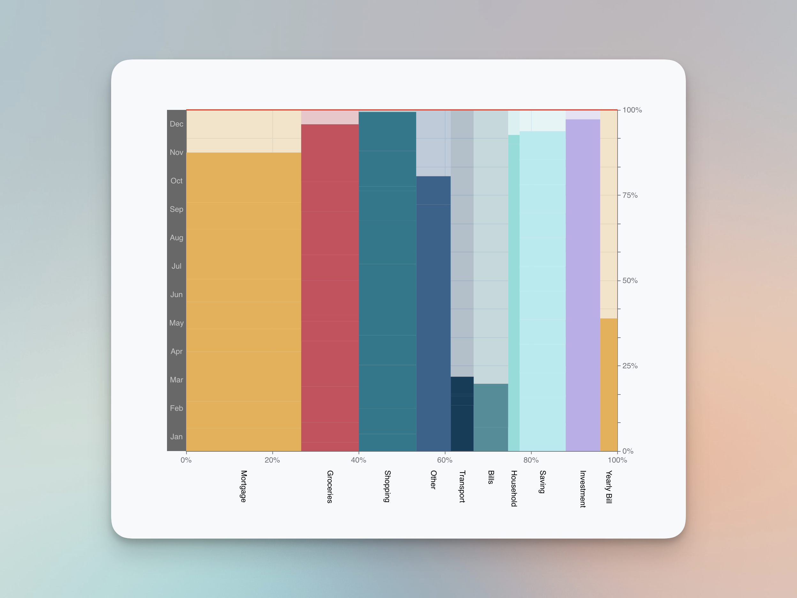
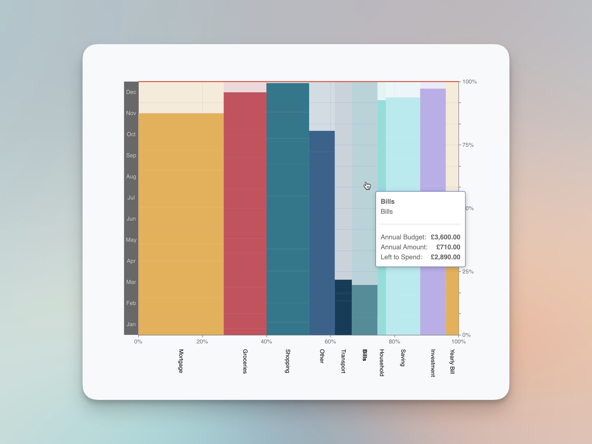
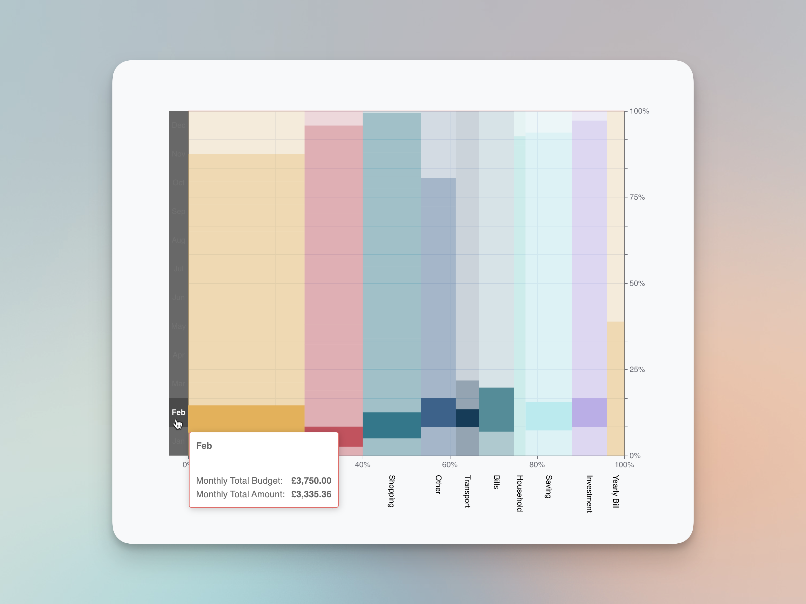
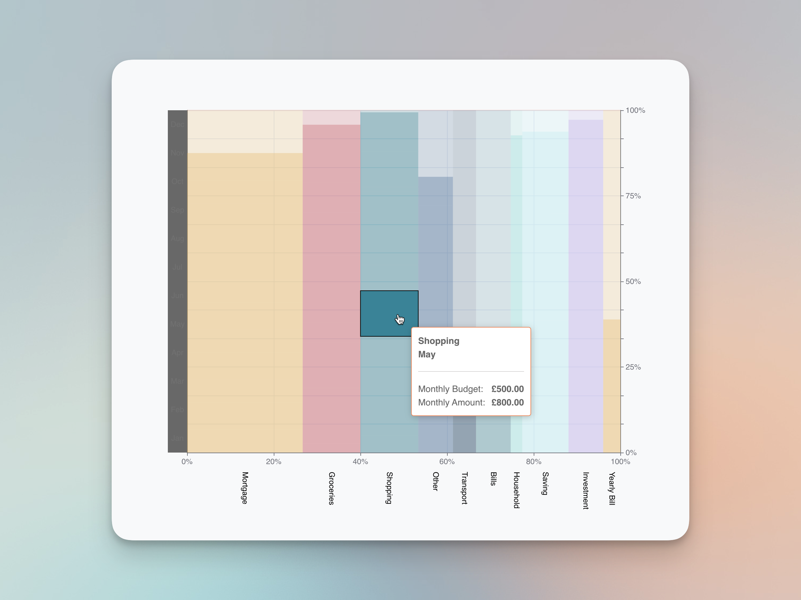
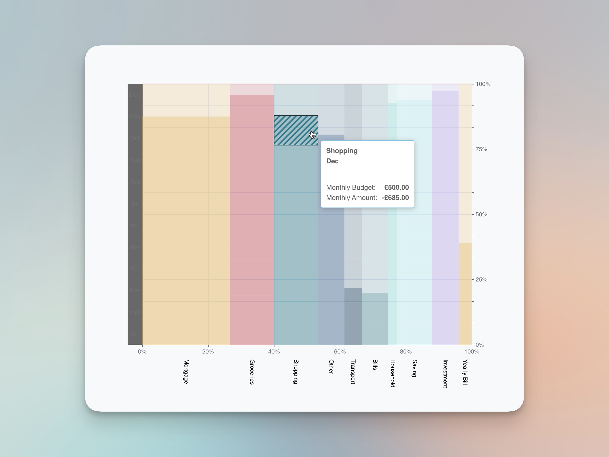
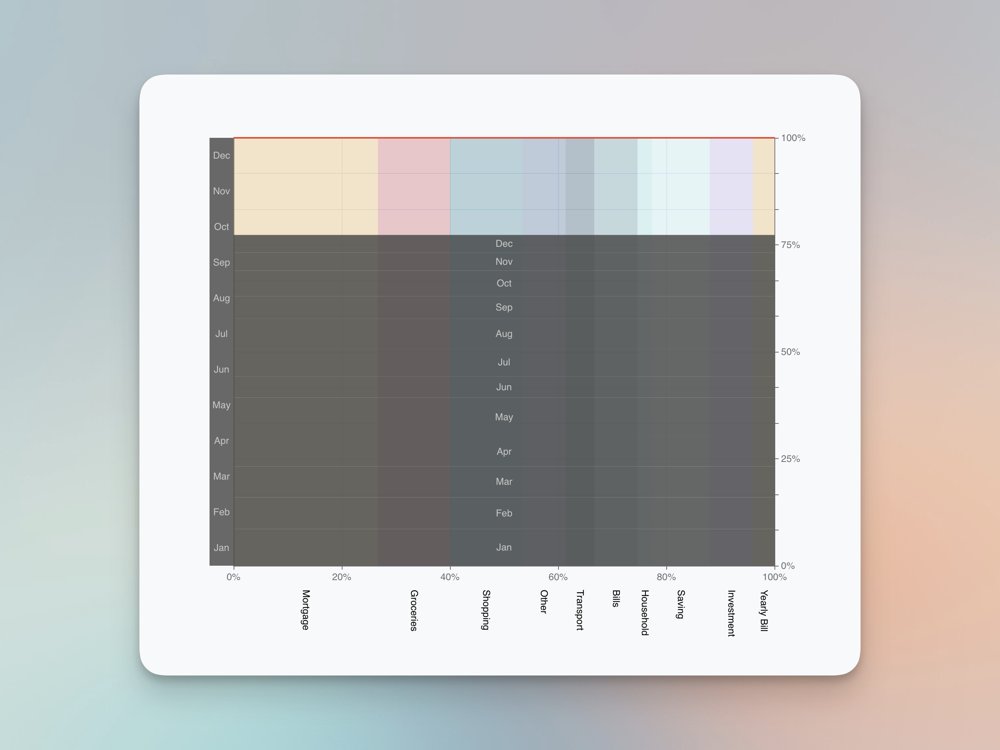
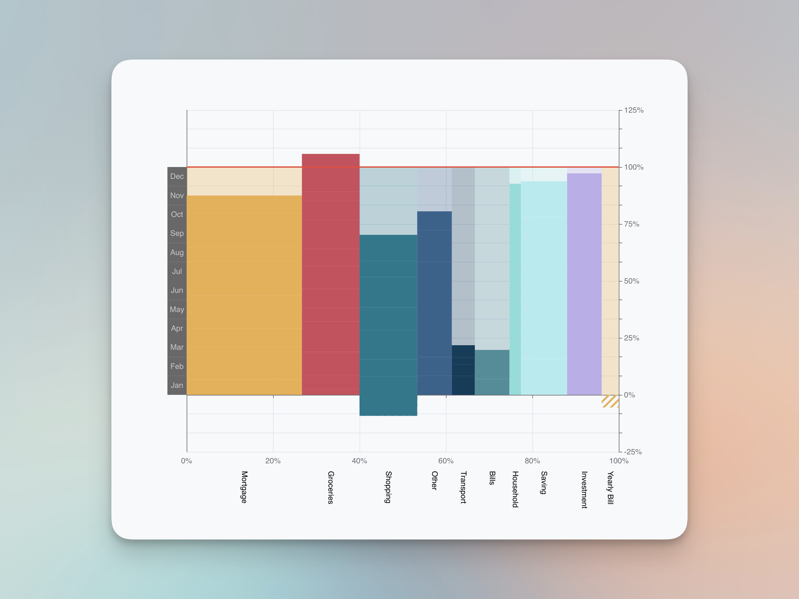
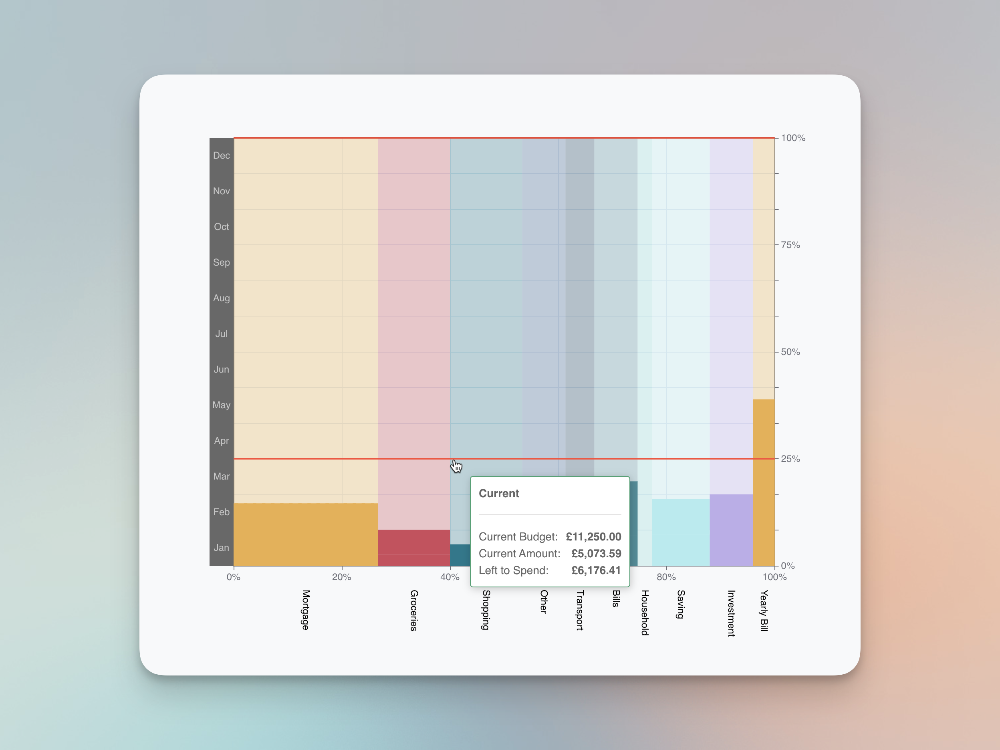

# budget-view-chart

[](https://github.com/ileodo/budget-view-chart/actions/workflows/static.yml)


[](https://www.npmjs.com/package/budget-view-chart)


<a href="https://www.buymeacoffee.com/Ileodo" target="_blank"></a>

A react Chart component specialising in display budget for personal finance.

> This component is built based on [echarts](https://echarts.apache.org/en/index.html).

[![Demo Button Icon]][Demo Link]

[Demo Link]: https://ileodo.github.io/budget-view-chart/
[Demo Button Icon]: https://img.shields.io/badge/Demo-EF2D?style=for-the-badge&logoColor=white


<p style="text-align:center;"></p>

## Get Started

```bash
npm install budget-view-chart
```

```react
<BudgetChart config={{
  showMonthEndLine: null,
  showAggregate: false,
  locale: 'en-GB',
  currency: 'GBP',
  theme: 'auto',
  themeColors: {
    light: {
      background: '#ffffff',
      text: '#263238',
      colorPalette: ['#edae49', '#d1495b', '#00798c']
    },
    dark: {
      background: '#111827',
      text: '#f9fafb',
      colorPalette: ['#ffd166', '#ef476f', '#06d6a0']
    }
  }
}} value={dataset}/>

```
Example `dataset` can be find in [demo/src/data/](demo/src/data/)

`theme` can be `'light'`, `'dark'`, or `'auto'`. It defaults to `'auto'`, which follows the system color scheme and updates when that scheme changes. `themeColors` lets you override colors for either mode. Each mode can set `background`, `text`, `axis`, `splitLine`, `legend`, `legendText`, `legendHighlightText`, `line`, `tooltipBackground`, `tooltipBorder`, `tooltipText`, and `colorPalette`. Unset colors use the built-in theme. The default background is transparent, so set the container background to match the theme unless you provide `background`. Each mode's `colorPalette` sets the budget item colors in order. Colors repeat when there are more budget items than colors. If you omit a palette or pass an empty array, that mode uses the built-in palette.

To run the demo with live changes to the library source, use Yarn 1:

```bash
yarn install
cd demo
yarn install
yarn start
```


## Visualisation

Breakdown View
<p style="text-align:center;"></p>

Highlight on Budget Item
<p style="text-align:center;"></p>

Highlight on Spending in a Whole Month
<p style="text-align:center;"></p>

Highlight on Spending
<p style="text-align:center;"></p>

Negative Spending (Income)
<p style="text-align:center;"></p>

Aggregate View
<p style="text-align:center;"></p>

Over Spending
<p style="text-align:center;"></p>

Current Line
<p style="text-align:center;"></p>


## Contribution

All contributions are welcomed, especially the following aspects:

- Standardise the repo
- Standardise the build/test/linting process
- Support custom styling
- Performance improvements
